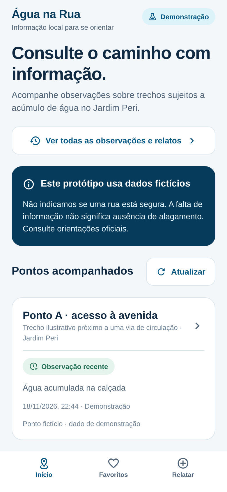
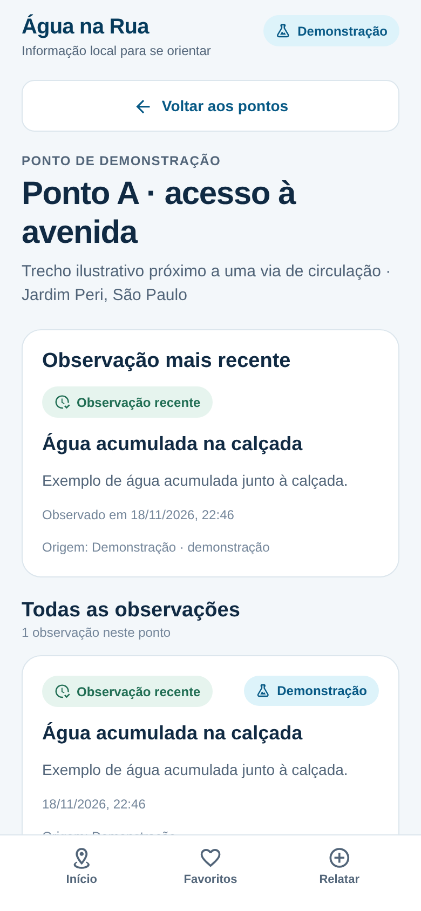
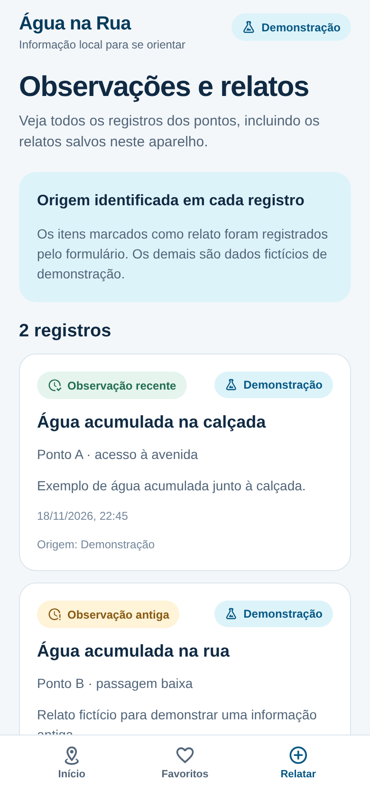
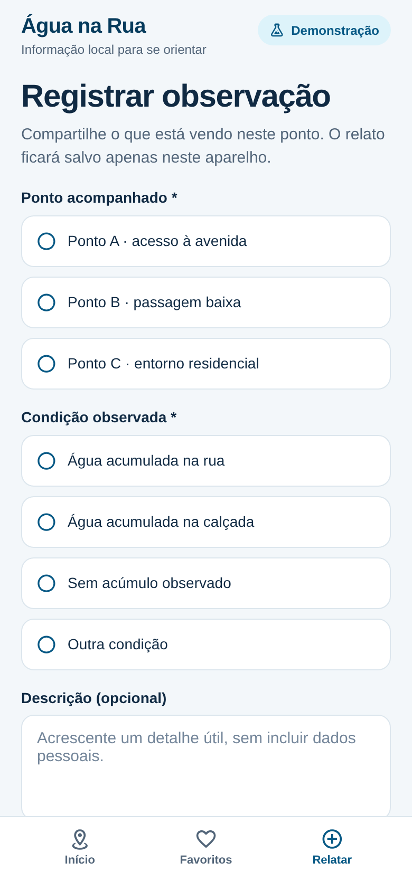

# Água na Rua — CitizenTech

Protótipo mobile para organizar observações sobre pontos sujeitos a alagamento no Jardim Peri, São Paulo. A interface distingue observações recentes, antigas e ausentes, mostra origem e horário, permite salvar favoritos e registrar relatos locais de demonstração.

> Os três pontos, observações iniciais e relatos cadastrados no protótipo são fictícios. Não representam condições reais de rua, não indicam se um trajeto está seguro e não recomendam atravessar áreas alagadas. Consulte orientações oficiais.

## Ficha CitizenTech (integral)

- *Nome:* Água na Rua.
- *Cidade e bairro:* São Paulo — Jardim Peri, com seleção de ruas e pontos específicos após validação com moradores.
- *Cidadão beneficiado:* moradores que precisarão circular por trechos sujeitos a alagamento, especialmente ao sair ou retornar do trabalho.
- *Problema em uma frase:* quem depende de ruas sujeitas a alagamento enfrenta dificuldade para encontrar informações recentes e localizadas sobre água acumulada no seu caminho.
- *Como funcionará:* o cidadão consultará pontos acompanhados, visualizará a última observação com horário e origem, salvará favoritos e poderá registrar uma nova ocorrência.
- *O que cada parte fará:* o software organizará as observações; o ML investigará padrões históricos de alagamento; o circuito demonstrará monitoramento local da elevação da água; infraestrutura, segurança e testes sustentarão a proposta.
- *Indicador de impacto:* será medido o tempo para encontrar a informação mais recente sobre um trecho. Também será avaliado se o usuário identificará corretamente sua origem, atualização e eventual ausência de informação.
- *ODS relacionados:* *ODS 11, meta 11.5, pela contribuição ao acesso à informação sobre desastres relacionados à água; **ODS 13, meta 13.1*, pelo apoio à preparação e adaptação comunitária. O protótipo não comprovará redução de danos ou vítimas.
- *Link do repositório:* [github.com/vitorbmulford/agua-na-rua-gs](https://github.com/vitorbmulford/agua-na-rua-gs).

## Proposta

O grupo desenvolverá um protótipo para organizar informações sobre pontos sujeitos a alagamento em um pequeno território. O recorte inicial terá aproximadamente três pontos, selecionados após conversas com moradores e investigação das condições atuais.

O Jardim Peri será investigado por possuir histórico documentado de problemas de drenagem. Como houve intervenções na região, a equipe verificará se os trechos escolhidos ainda apresentarão uma necessidade relevante de acompanhamento.

Cada observação mostrará local, horário, origem e condição relatada. O aplicativo distinguirá informação recente, informação antiga e *ausência de informação*. A falta de registros não será apresentada como garantia de passagem livre, e a solução não recomendará atravessar áreas alagadas.

As disciplinas compartilharão o mesmo problema, cidadão e conceito. Os componentes poderão funcionar separadamente, mantendo as conexões descritas abaixo.

## Participação das oito disciplinas

| Disciplina | O que o grupo construirá ou demonstrará |
|---|---|
| *SOA e Web Services* | Desenvolverá uma API para consultar pontos e registrar observações, com domínio organizado, banco, migrações, documentação dos endpoints e testes automatizados. |
| *C# Software Development* | Utilizará o mesmo backend de SOA em C#/.NET, demonstrando POO, interfaces, injeção de dependência, Web API, EF Core, LINQ, operações assíncronas e testes unitários. |
| *IA & Machine Learning* | Investigará padrões de recorrência e sazonalidade das ocorrências públicas de alagamento. Utilizará KMeans + PCA para explorar agrupamentos de áreas e apoiar a escolha de pontos para monitoramento. O notebook será independente do aplicativo. |
| *Mobile Development & IoT* | Desenvolverá um app com React Native, TypeScript, Expo e Expo Router para consultar pontos, visualizar observações, salvar favoritos e registrar ocorrências. Consumirá API ou mock identificado e utilizará SQLite para persistência local. |
| *Operating Systems* | Provisionará uma VM Linux por Shell Script para executar a API e uma página web de acompanhamento. Demonstrará serviços, monitoramento, logs e recuperação após falha. |
| *Physical Computing* | Simulará no Wokwi um ESP32 com sensor ultrassônico, display e sinalização. A variação da distância representará a elevação da água, sem exigir conexão com o app. |
| *Cybersecurity* | Demonstrará identificação de PII nos relatos, taint analysis, bloqueio ou sanitização de saídas inseguras, explicação dos achados por LLM e painel de Risco Cidadão, seguindo o material anterior da disciplina. |
| *Testing, Compliance & QA* | Organizará Features, critérios de aceite e testes positivos e negativos no Azure Boards. Reunirá evidências em PDF e apresentará a proposta em pitch de até quatro minutos. |

## Dados públicos para Machine Learning

A fonte principal será o [GeoSampa — ocorrências de alagamento](https://metadados.geosampa.prefeitura.sp.gov.br/geonetwork/srv/api/records/432c06b1-03a1-4b1f-9210-423e1b58e869). O catálogo oficial informa registros da Defesa Civil/SIGRC e histórico disponível desde *2013*.

O recorte pretendido será *2013–2025*. Download, campos, cobertura e consistência ainda precisarão ser verificados. A análise representará ocorrências registradas, não todos os alagamentos existentes.

Serão avaliadas pelo menos dez combinações de três hiperparâmetros, com validação apenas no treino e avaliação separada. O estudo não prometerá prever a próxima enchente.

## Limites da demonstração

- *Dados reais:* histórico público utilizado no ML e informações territoriais que forem verificadas.
- *Dados de demonstração:* leituras do Wokwi, mocks e relatos fictícios para testes, sempre identificados.
- *Evoluções futuras:* sensores instalados, transmissão automática, notificações e integração entre dispositivo e aplicativo.

*Nota à equipe:* esta Ficha deverá permanecer igual nos READMEs das disciplinas. Os prompts utilizados serão registrados em prompts.md.

## App

### Tecnologias e estrutura

- React Native, Expo SDK 58, TypeScript e Expo Router.
- Expo SQLite para favoritos e relatos locais.
- Mock assíncrono tipado separado do serviço de consulta.
- Componentes reutilizáveis e tokens visuais em `src/constants/theme.ts`.

Na tela de detalhes de cada ponto, a seção “Todas as observações” reúne os exemplos iniciais e todos os relatos gravados no aparelho, em ordem do mais recente para o mais antigo. A lista inicial dos pontos continua mostrando um resumo da observação mais recente.

Rotas: início (`src/app/index.tsx`), detalhes (`src/app/points/[id].tsx`), histórico completo de observações e relatos (`src/app/observations/index.tsx`), formulário (`src/app/observations/new.tsx`) e favoritos (`src/app/favorites/index.tsx`). Banco e operações estão em `src/database/database.ts`; dados ilustrativos em `src/mocks/points.ts`.

### Executar

```bash
npm install
npx expo start
```

Use o QR code no Expo Go ou pressione `w` para abrir a versão web. Para compilar a tipagem: `npx tsc --noEmit`. Para lint: `npx expo lint`.

### Banco SQLite

A base local `agua-na-rua.db` é inicializada na primeira consulta e cria as tabelas `favorites` e `reports`. Favoritos e relatos permanecem após fechar o app no mesmo aparelho. Relatos não são enviados para servidor.

### Dados de demonstração e estados

Há três pontos fictícios, com uma observação recente, uma antiga e uma ausência. O limite de 24 horas para “recente” é convenção deste protótipo, não critério oficial de segurança. Favoritos e relatos locais são armazenados no SQLite.

Para demonstrar os estados, defina a variável antes de iniciar o Expo:

```bash
EXPO_PUBLIC_DEMO_STATE=error npx expo start
EXPO_PUBLIC_DEMO_STATE=empty npx expo start
```

`error` mostra erro compreensível e ação de tentar novamente. `empty` retorna lista vazia. Sem variável, a consulta assíncrona normal exibe carregamento breve e os três mocks. A variável é incorporada no bundle; reinicie o servidor ao mudar.

### Physical Computing — GS

O circuito ESP32/HC-SR04/LCD/LEDs/buzzer está em [`physical-computing/wokwi`](physical-computing/wokwi). O guia em [`physical-computing/README.md`](physical-computing/README.md) descreve como montar/publicar no Wokwi. O circuito funciona separado do aplicativo, sem Bluetooth, MQTT ou transmissão de leituras. Os limites são apenas didáticos.

**Link público do projeto Wokwi:** pendente de publicação na conta da equipe.

### Prints e vídeo

- Capturas das telas em viewport móvel (390 × 844), feitas na versão web responsiva do app:
  - **Início:** 
  - **Detalhe do ponto:** 
  - **Observações e relatos:** 
  - **Registrar observação:** 
**▶ VÍDEO DEMONSTRATIVO DO APP — 1 min 31 s:** [assistir ao vídeo](docs/video/RPReplay_Final1795104160.mp4).
- Vídeo de Physical Computing (até 4 min): link pendente; roteiro em [`entregaveis/roteiro-video-physical-computing.md`](entregaveis/roteiro-video-physical-computing.md).

### Integrantes

- Milton Cezar Bacanieski — RM 555206
- Lorenzo Hayashi Mangini — RM 554901
- Vitor Bebiano Mulford — RM 555026
- Victório Maia Bastelli — RM 554723

Lista para entrega em texto: [`entregaveis/integrantes.txt`](entregaveis/integrantes.txt).

### Limitações e evoluções

Os pontos reais dependem de validação comunitária. Mocks e circuito são demonstrações; a aplicação não consulta o ESP32. Evoluções podem considerar API, validação dos trechos e sensores instalados, mantendo origem e horário explícitos.
